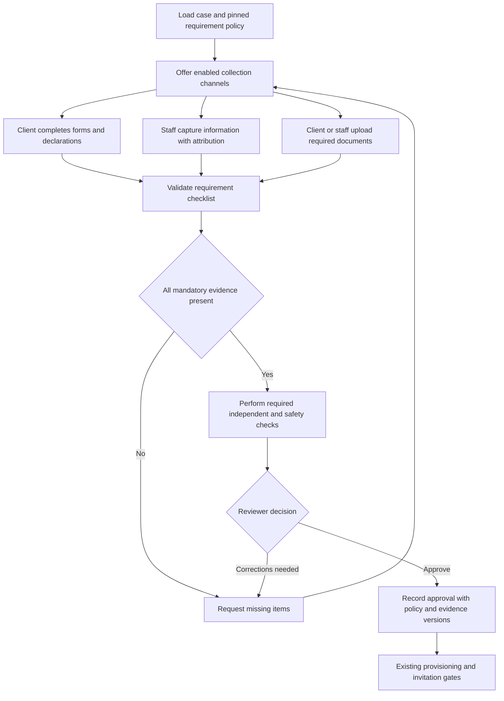

# Paperless KYC and automation design

Date: 2026-11-11. Status: recommended design for implementation. Existing client-link and platform document uploads remain implemented. Structured forms, the flags below, evidence requirement policies and automatic verification are not implemented by this document.

## Decision

Use one KYC case with several permitted evidence methods. Clients can complete structured forms and declarations, staff can capture information received from the client, and both can supply required documents. A hybrid case will often be the normal path. Paperless means avoiding unnecessary printing, scanning and retyping while preserving sufficient evidence.

The product's policy must state what satisfies each requirement. Some information can be a declaration; some needs a reliable independent source or document. A typed identifier, email OTP, provider login or PDF generated from a form does not automatically establish identity, ownership or authority. FATF's [digital identity guidance](https://www.fatf-gafi.org/en/publications/financialinclusionandnpoissues/documents/digital-identity-guidance.html) discusses assessing reliability, independence and assurance for digital identity in customer due diligence. Its financial-sector context does not define a universal policy for this domain-neutral template. The downstream product owner must confirm the applicable jurisdiction, industry, evidence and retention rules.

## Shared case, separate responsibilities

| Information or requirement | Paperless path where permitted | Documentary or independent evidence when required |
| --- | --- | --- |
| Organization details | Structured registered name, identifiers, address and business purpose. | Approved registry response or registration evidence. |
| Authorized representative | Named representative, role and authority declaration. | Authorized-signatory evidence or independent authority check. |
| Ownership and control | Structured ownership/control declaration where relevant. | Registry or policy-required supporting evidence. |
| Product use and commercial intent | Intended use, modules, contact details and trial/paid request. | Supporting evidence required by the product's risk policy. |
| Declarations and consent | Exact versioned text, deliberate acknowledgement and submission snapshot. | Additional signature assurance if the applicable policy requires it. |

Do not collect every example field by default. The downstream policy selects the minimum necessary information. Platform staff must not attest as the client: record who entered information, on whose behalf, the source and when. A client's acknowledgement must bind to the exact submitted version; material changes invalidate that acknowledgement until confirmed again. Link possession identifies a submission capability, not a verified legal person.

## Feature flags and policy

Proposed flags use the existing FeatureFlags abstraction and a ControlPlane-owned policy resolver for the target case. A pending customer has no normal active tenant entitlement or IAM session, so the anonymous submission flow must resolve its persisted case/link and the vendor's policy. It must not use a caller-supplied tenant ID or an unrelated signed-in workspace as authority.

| Proposed flag | Controls | Initial implementation default |
| --- | --- | --- |
| kyc.client.forms | Client structured forms and declarations. | False until implemented and tested. |
| kyc.platform.forms | Staff-assisted structured capture. | False until implemented and tested. |
| kyc.client.uploads | Client upload channel. | True when this runtime gate is implemented. |
| kyc.platform.uploads | Platform upload channel. | True when this runtime gate is implemented. |
| kyc.reminders | Automated collection reminders. | False until durable delivery and stop rules are implemented. |
| kyc.verification.automated | Required configured verification adapters. | False until certified; manual review remains available. |

These keys are a proposal, not settings that can be enabled in the current runtime. Do not add inert configuration keys and present them as working controls.

An enabled flag makes a method available; it does not grant permission, prove KYC or waive a requirement. Backend enforcement must match UI visibility. Platform identity plus the appropriate operation permission controls staff access. Client links carry narrow capability scopes, case identity, expiry and issuance identity. Enabling forms must not silently expand an already-issued upload-only link; issue a new capability for the new scope.

Support uploads-only, permitted forms-only and hybrid configurations. Forms-only is valid only when every applicable requirement can be met without document upload. Reject a policy/flag combination that requires an upload but disables every permitted upload route. Reject disabling all collection methods for an open case. Preserve read access, submitted evidence, policy versions and review history when a method is disabled; notify the operator about affected drafts and offer an approved alternative. Do not silently broaden evidence acceptance.

KYC is mandatory. Do not introduce a kyc.required=false bypass. Vendor-controlled requirement policy should not become an arbitrary customer organization setting. Global operational flags, any vendor-approved case override and requirement policy must have clear precedence, audit and server-side validation.

Start with shipped, versioned form definitions and typed validation. A general form-builder product is not a prerequisite. Keep jurisdiction- or industry-specific evidence rules in the downstream policy extension, with a provider-neutral contract at the template boundary.

## Implementation shape and order

1. Add a versioned ControlPlane KYC case/requirement model linked to the existing workspace. Preserve existing Tenant KYC approvals and evidence references during migration.
2. Implement policy resolution, four collection flags and capability-scoped links with negative API tests before exposing new screens. Use typed modes at the configuration boundary.
3. Build a complete client form slice: save draft, validate, submit a versioned snapshot, acknowledge declarations and see requested corrections. Keep uploads in the same case.
4. Build staff-assisted capture, source attribution, independent reviewer decisions and history. Use independent collection, document-review and final-approval operation permissions; the reserved `control_plane.manage` key is retired. Retention policy administration and legal holds also have separate permissions.
5. Add reminder and progress notifications using durable jobs/outbox, idempotency, suppression and safe message content.
6. Add document safety and evidence verification through isolated adapters, then measured low-risk automation where explicitly approved.

Proposed case states include Draft, Submitted, MoreInformationRequired, UnderReview, Approved, Declined and Withdrawn. These are not current TenantStatus values. Provisioning state remains a separate concern, so infrastructure failure does not erase an approved case. Use revision checks to prevent approval of stale forms or evidence. Re-evaluate policy and evidence at the final decision; record policy version, requirement outcomes, reviewer, timestamp and supporting references.

IronOCR is a possible adapter for text extraction and assisted comparison. It does not prove that an extracted document is genuine. QuestPDF can render a submitted case summary or decision report from the persisted snapshot; keep original structured data and provenance as the evidence record. The reported Iron partnership sandbox is a development constraint. Confirm the actual deployment entitlement before production use; consult [IronOCR licensing](https://ironsoftware.com/ocr/csharp/licensing/) and [QuestPDF license eligibility](https://www.questpdf.com/license/guide.html) for the selected deployment.

## Completion evidence

Test each supported flag combination through both API and UI; direct calls to disabled channels must fail. Prove required documents cannot be replaced by an unchecked declaration, forms cannot change after acknowledgement without a new version, reviewers cannot approve stale data, and staff capture cannot impersonate client attestation. Test expired/rotated links, cross-workspace IDs, concurrent edits and changed policy. Record real identity/registry provider acceptance independently from local deterministic adapter tests.

The [onboarding journey](tenant-onboarding-journey.md) records when to automate based on workload. The [verification and retention checklist](../development/kyc-verification-and-retention-closure.md) separates outstanding authenticity processing and cloud certification from the enabled [application retention workflow](../development/kyc-retention-policy.md).
