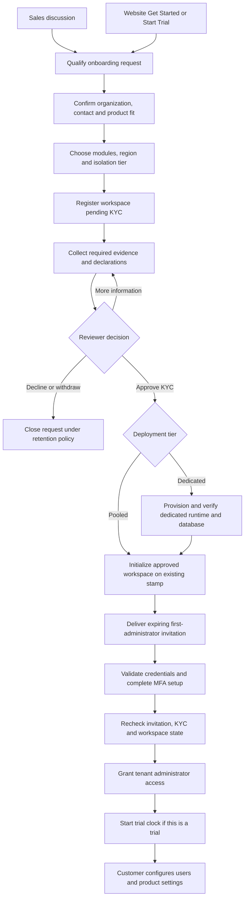
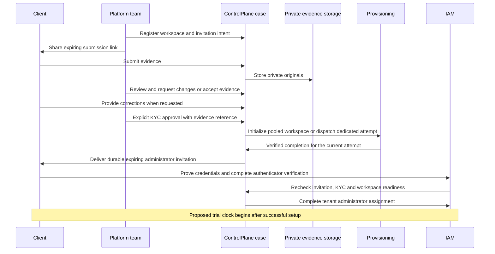

# Tenant onboarding journey

Date: 2026-11-11. This is the business journey for downstream products built from StarterTemplate. Read it with [secure workspace onboarding](secure-workspace-onboarding.md), the [provisioning runbook](tenant-onboarding-workflow.md), and the [paperless KYC design](kyc-paperless-and-automation.md).

## What exists and what is proposed

| Step | Current status |
| --- | --- |
| Sales discussion and qualification | Operational activity outside the template. |
| Website Get Started / Start Trial request | Proposed public intake slice. There is no shipped lead capture or trial clock in ControlPlane. |
| Register customer workspace and initial administrator invitation intent | Implemented in Control Panel. Registration does not grant customer access. |
| Collect evidence through a client submission link or platform upload | Implemented. Private originals, status, feedback and review history are retained. |
| Structured paperless forms, independent digital checks and declarations | Proposed; see the paperless design. Uploads remain supported. |
| Explicit KYC approval and provisioning gate | Implemented. Requires the platform reviewer and evidence reference. |
| Pooled initialization, durable administrator invitation, credentials and MFA | Implemented, with local API/integration acceptance. Provider browser evidence has its own recorded scope. |
| Dedicated stamp deployment workflow | Implemented source and local provider checks; cloud runtime, ingress and recovery certification remain pending. |
| Trial begins when administrator setup completes | Recommended product rule, not implemented trial billing or scheduling. |
| Collection reminders, case progress notifications and automated evidence checks | Proposed automation. Invitation delivery already has its own durable worker. |

## From first contact to an active customer

The sales-assisted route and the public trial route should produce the same onboarding request. Sales records what was agreed: organization, contact, intended product, requested modules, likely users, region, isolation requirements and trial or paid intent. A public request records the corresponding minimum information and acknowledges receipt. Neither route should immediately create an unrestricted account or an active workspace.

The platform team qualifies the request, resolves duplicates, confirms the intended administrator and chooses a pooled or dedicated stamp. Staff then register the workspace and start the KYC case. The future public request needs an explicit, idempotent conversion into that workspace; this is not an anonymous tenant-creation API.

The diagram shows the intended complete product journey. Public intake, request decline/withdrawal workflow, trial scheduling and paperless declarations are design steps, not additional implemented TenantStatus values.

A reviewer checks evidence against the product's policy, requests corrections where needed, and records a deliberate approval. Collecting a file, extracting its text, verifying an email address or connecting Google/Microsoft does not itself approve KYC. Staff may process the case manually for the long term; that is a valid operating model.

A pooled customer uses an existing stamp after the KYC gate. A dedicated customer also needs a verified provisioning result for the current attempt before activation. Infrastructure failure must preserve the case and approval, expose a useful status and permit a controlled retry. A stale completion cannot activate a newer attempt.

The initial invitation is separate from an IAM account. Registration can persist invitation intent, but delivery waits for readiness. Credential validation creates restricted setup; existing accounts prove their established sign-in method. Final administrator authority follows MFA and final invitation/workspace checks. Passwords are never delivered by email.

## KYC and activation sequence

## Trial, Demo and paid onboarding

A real trial is a real customer workspace and still requires KYC. Start its clock only after the first administrator successfully completes setup. Use one persisted UTC start instant and an idempotent completion event so retried setup cannot restart the trial. Record duration, expiry, conversion and suspension policy separately from provisioning time. These trial fields and transitions still need implementation.

The vendor Demo workspace serves immediate previews with safe fixtures. It does not substitute for a customer's KYC or contain customer evidence. Paid and trial customers use the same identity, isolation and review gates; payment confirmation is an additional downstream commercial rule where applicable.

## Where to automate, and when

Automation should follow measured workload and review needs. Track open cases, collection turnaround, overdue cases, manual touches, reminder response, exception rates and provisioning failures. Set the service targets for the product, rather than inventing a universal customer-count threshold.

| Automation | Trigger for investment | Required safeguards |
| --- | --- | --- |
| Intake acknowledgement and duplicate detection | Requests are being missed or repeatedly entered. | Idempotent request identity, abuse controls, no anonymous activation. |
| Required-item checklist and structured collection | Staff repeatedly request the same information. | Versioned policy and server-side validation; documents where required. |
| Reminders and progress updates | Collection delays and status enquiries consume staff time. | Consent/contact policy, delivery deduplication, rate caps, stop on closure, no sensitive evidence in messages. |
| Registry or identity-provider checks | Reliable sources exist and repeated checking is costly. | Source provenance, confidence and expiry rules, exception review. |
| Provisioning dispatch and progress | Dedicated onboarding volume justifies operational automation. | Existing KYC gate, attempt IDs, leases, verified completion and recovery. |
| Automatic low-risk decisions | A defined policy and measured evidence support them. | Explicit delegated decision policy, audit trail, escalation and reversibility; human approval remains the default. |

Automating collection does not require automatic approval. Staff-assisted review can remain the permanent choice for low volume, high-value or complex customers. A later phase is justified by workload and service quality, not by calling a correct manual process unfinished.

## Operator handover checklist

- [ ] Confirm legal/product KYC policy, accepted evidence methods, required documents and review responsibility.
- [ ] Confirm contact, intended administrator, trial/paid intent and requested entitlements.
- [ ] Select approved region, pooled/dedicated tier and environment configuration.
- [ ] Collect, review and approve KYC with stable actor, UTC timestamp and evidence reference.
- [ ] Verify the current provisioning attempt, schema and stamp ownership before activation.
- [ ] Confirm private evidence access and invitation delivery; follow acceptance through credentials and MFA.
- [ ] Record trial start only after successful administrator setup when trial scheduling is implemented.
- [ ] Test tenant isolation, platform and tenant permissions, revocation and suspension.
- [ ] Record manual/browser/API/cloud evidence separately. Follow the [downstream checklist](../development/downstream-configuration-checklist.md).
