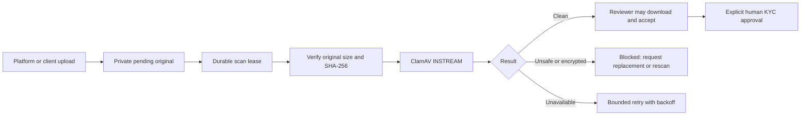

# Account admission and KYC file safety

This change closes tenant identity inconsistency, concurrent account admission and unsafe original-file access. It preserves StarterTemplate's IAM, mandatory KYC, tenant/stamp ownership and retention model. Cloud deployment certification and automated document authenticity checks remain separate acceptance work.

## Tenant account admission

Username and email uniqueness belong to the resolved workspace. The same person can hold separate identities in different customer workspaces. A deleted identity remains reserved in its original workspace; deletion does not transfer credentials or silently reactivate that identity. Both normalized username and normalized email have tenant-scoped unique indexes.

`TenantUserStore` protects Identity creation, identity-key changes and restoration at the storage boundary. SQL Server uses a transaction-owned application lock; PostgreSQL uses a transaction-owned advisory lock. The key is scoped to the tenant. A caller-owned IAM transaction retains the lock until its commit or rollback, so role/profile failures cannot leave a successful seat reservation behind. SQL Server and PostgreSQL are the supported runtime providers; SQLite is a unit-fixture fallback.

`MaxUsers` counts every non-deleted human account, including inactive accounts and incomplete administrator setup. Zero means unlimited. Trusted support and Demo proxies use an explicit persisted account kind, assigned only by trusted runtime flows. A username or role label does not exempt an account. Restoring a deleted human account consumes a seat and is rejected at capacity. Lowering a configured limit does not delete or deactivate existing accounts; it blocks subsequent admissions. An in-flight admission uses the policy observed under its IAM lock; a simultaneous control-plane policy edit is not a distributed transaction with every dedicated database.

The central control-plane limit must be readable, including from dedicated stamp hosts. Missing workspace configuration fails admission. Independent workspaces retain independent locks and identities. Direct database inserts are trusted maintenance operations and must preserve these invariants; application account creation goes through Identity.

## File safety is separate from KYC review



The existing private evidence container is the quarantine boundary. The worker runs on an unbound central host or a stamp that owns the reserved platform workspace; a dedicated customer runtime cannot lease the central evidence queue using its own storage/scanner configuration. Pending originals never have public URLs and cannot be downloaded through the application. A clean scan grants neither identity authenticity nor workspace approval. Review feedback remains client-visible; the final KYC decision still requires authorized platform review and an evidence reference.

Each document persists state, attempts, next attempt, expiring lease, check time, engine/definition versions and a safe reason code. Revision-based concurrency rejects stale scanner results after erasure or retry. A crashed worker's lease expires. Dependency failures retry at 30 seconds, then exponential intervals capped at 15 minutes, with five attempts by default. Exhaustion is visible as Failed. Reviewers with `control_plane.review_kyc_documents` can request another scan using the current revision; they cannot mark a file clean. Existing permission constants are authoritative if a downstream renames keys.

Clean, Unsafe, Blocked and Failed are separate from Accepted/Changes requested. Accepting an individual document requires Clean. KYC approval blocks uncleared evidence still under consideration; explicitly requesting changes excludes that unusable evidence from the approval gate. Reviewers must still obtain the required valid evidence. Retrying provisioning after an already approved KYC decision preserves the established approval and retention rules.

Before scanning and before every download, a private bounded temporary spool verifies the original length and SHA-256. Changed/missing bytes cannot be downloaded using an older clean verdict. Spools are deleted on close and have owner-only Unix permissions. Retention and independent erasure-ledger checks remain mandatory. A restored database cannot authorize evidence recorded as erased in the independent ledger.

## Configuration and local operation

The `KycDocumentSafety` section is present in API appsettings. ClamAV is the supported adapter; unknown providers fail startup. Native hosts use `localhost:13315`; Docker API uses `clamav:3310`. The pinned local `clamav/clamav:1.5.4` service is part of normal infrastructure setup and persists updated signatures in its own volume. Run the endpoint audit before starting the updated Compose configuration. Allocate a different scanner host port for a downstream clone.

```powershell
.\scripts\check-local-endpoints.ps1 -ComposeFiles @('ops/local/docker-compose.yml', 'ops/local/docker-compose.apps.yml')
docker compose --env-file ops/local/.env -f ops/local/docker-compose.yml up -d --wait clamav
```

The host mapping binds only to loopback. ClamAV's TCP protocol has no built-in authentication or encryption. Keep Docker access private; do not expose port 3310 publicly. For another private scanner endpoint, configure Host/Port and validated TLS where the service supports it. Provision capacity for the scanner and persistent definitions; allow several minutes for initial signature loading. Keep `AlertEncrypted` and `AlertExceedsMax` enabled and scan limits aligned with the 10 MiB upload bound. The supplied config uses UTC; its Linux line endings are enforced by `.gitattributes`.

Definitions must be available, not future-dated beyond five minutes, and no older than 72 hours by default. Version responses before/after a scan must match; a reload during a scan causes a retry. No disabled/no-op provider can produce a production Clean result. Monitor scanner health, definition age, failed attempts and the KYC review queue. The service health check proves availability; the application additionally checks definition freshness.

For cloud, provision this trusted scanning dependency (or implement and separately certify another adapter) and configure the private endpoint, storage and permissions. Azurite does not include antivirus. Azure Blob alone does not include this application scanner. Do not equate local certification with a deployed scanner, Defender event identity, backup/restore or dedicated-runtime certification.

## Existing database upgrade

1. Back up the database and private evidence/independent ledger according to the existing recovery runbook. Pause API writers, including native and Docker instances.
2. Run `scripts/update-local-database.ps1` before `-Apply`. The existing guarded workflow checks all three context histories and model drift.
3. The IAM migration stops on duplicate non-null normalized emails within one tenant. Resolve ownership explicitly; it never merges accounts, deletes accounts or resets credentials. Cross-workspace duplicates are permitted.
4. Legacy support/Demo proxies are classified only when paired actor/proxy claims, generated username/email and original creator match. Other accounts remain Human and count toward the limit.
5. The control-plane migration marks existing non-erased evidence Pending and schedules scanning; erased metadata remains Erased. Prior acceptance never silently supplies a clean scan.
6. Restart matching API/UI revisions and the configured scanner. Confirm no pending migrations, current definitions, healthy apps and settled scan results. Existing originals stay unavailable while the backlog is scanned.

Schema downgrades remove safety gates and proxy classification. Prefer a tested forward fix with compatible API/UI/database revisions; do not run an older binary against the upgraded workflow as an implicit rollback.

## Verification record

Provider-backed concurrency, upgrade and KYC acceptance results are recorded in the completion entry in PLAN.md. Unit protocol fixtures cover malformed/stale/truncated definitions, changing definitions, unsafe/encrypted/limit results and checksum failures. The KYC integration uses disposable SQL Server, Azurite and real ClamAV with synthetic clean, encrypted and EICAR antivirus-test content. No customer evidence or credentials belong in fixtures.
