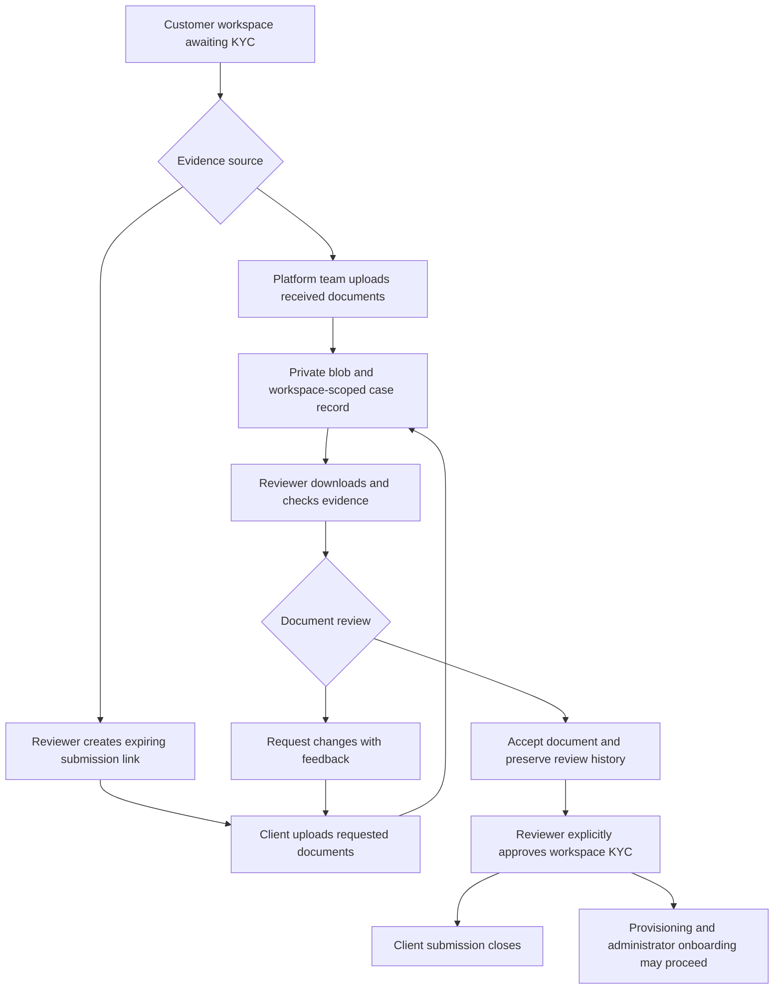

# KYC documents and client submissions

Platform reviewers open Control Panel → KYC Cases. Viewing requires explicit platform identity, MFA and `control_plane.view_kyc`; upload, link management, download, review and final approval each require their own `PlatformPermissions` operation. The retired `control_plane.manage` key grants nothing. The page is available while the customer workspace is pending approval.

Reviewers can upload evidence received from the client, download safety-cleared private originals, and append an accepted or changes-requested decision with feedback. Earlier reviews remain in the history. Feedback is labelled as client-visible. KYC approval remains an explicit reviewer decision with its evidence reference. An accepted individual document does not automatically approve the workspace.



## Document-specific collection

The platform case uses two tabs: **Upload Documents** contains collection followed by the client submission link; **Documents & Decision** contains the document table, review history/form and final KYC decision. Tabs retain their state, including unsent file selections. Both collection pages use a three-column document grid on wide screens, two columns on tablets and one column on phones. The client link uses a wide onboarding card rather than the narrow sign-in form. Upload histories are expandable to keep collection compact.

Both the platform case page and the client submission page show an individual file picker and upload action for each configured document type. The default catalogue covers business registration, tax registration, representative identity, representative authority and business address. Collect the evidence applicable to the customer and requested by the reviewer; displaying a type is not a declaration that every customer must supply it. KYC approval remains a deliberate, permission-protected review decision, including externally verified evidence where applicable.

Use **Add document** for additional files, such as another representative's ID or the reverse of an ID. Each added row selects a catalogue type or **Other**. Other requires a document name of at most 80 characters. Changing the row's selected type clears its file selection so the next upload is an explicit choice for that type. Removing an unsent row does not delete an earlier upload. Each upload is saved separately, with its own private object, checksum, review history and retention lifecycle.

The platform document table filters by type. Both screens display the same server-owned catalogue; client inspection returns it only after submission-link validation. The client still sees only documents submitted through that link issuance.

### Adding future types

Edit `KycDocuments:DocumentTypes` in the API configuration, then restart/redeploy the API. No new database migration or UI edit is needed. For example, append:

```json
{
  "Key": "sector-license",
  "Name": "Sector license",
  "Guidance": "Upload the current license for the regulated activity, if requested."
}
```

Keys must be unique lowercase ASCII letters/digits/hyphens, at most 64 characters. Names are at most 80 characters and guidance at most 240. The catalogue supports 1–30 entries. `other` and `legacy` are reserved. Keep existing keys stable when changing labels. Configuration is platform-owned; a client cannot introduce a new catalogue key by posting an upload.

Uploads send the selected key in the existing multipart `DocumentType` field and, for Other only, `OtherDocumentName`. The server resolves standard labels itself. It persists `DocumentTypeKey` for grouping/querying and `DocumentType` as the captured display name (the client's supplied name for Other). A tenant/type/upload-time index supports queries. The platform API accepts `GET .../kyc/documents?documentTypeKey=tax-registration`, preserving its existing tenant and permission checks. Blob keys remain opaque workspace/document identifiers; classification comes from the database rather than a filename or storage path.

Identical-content retries are scoped to the workspace, uploader/link issuance and selected classification. The same bytes can therefore be recorded under two different document types or differently named Other documents without silently returning the first classification. Keep label changes coordinated across API instances.

### Existing databases

Apply **ClassifyKycDocuments** for the selected ControlPlane provider; SQL Server and PostgreSQL migrations are included. Existing free-text uploads retain their name and receive the `legacy` key, shown in the platform filter as **Earlier uploads**. They are not automatically assigned to a type based on filenames or guessed contents. They retain their classification and review history; the safety upgrade requires them to pass scanning before downloading or acceptance. There is no retrospective reclassification editor in this change.

The migration is additive but changes upload deduplication. Once identical content exists in different classifications, reverting to the older unique index may fail. Use the verified backup/forward-upgrade process rather than assuming a lossless schema downgrade. Deploy API and UI together because the upload contract now requires a catalogue key or explicit Other name.

## Client submission links

Create a submission link from the KYC documents page and share it with the intended client. Issuance returns the secret once. The URL carries the token in its fragment, which is excluded from normal HTTP request URLs and referrers. The interactive page keeps it in component memory and submits it in request bodies. Request-body logging excludes multipart uploads and redacts JSON token fields.

The database stores only the SHA-256 token hash. Links expire after 48 hours by default and permit 20 successful unique uploads. Creating a replacement link invalidates the previous token. Revocation and KYC approval close submissions. Link users can see filenames, status, and feedback for the documents uploaded through that issuance. Original document download and platform-uploaded documents require reviewer access.

A submission link grants access by possession. Send it only to the intended submitter. The public page creates no IAM account and grants no workspace or administrator access.

## File handling

PDF, JPEG, and PNG files up to 10 MiB are supported. The API checks the actual file length, filename, extension, and leading file signature. It computes SHA-256, stores each original under a generated workspace/document key, and reuses an existing document when the same uploader or submission issuance retries identical content. A replacement link can receive the same content independently and display it in its own submission history.

Blobs stay in a separate private kyc-documents container. Downloads pass through the permission-protected API, use an attachment disposition and no-store caching, and match both workspace and document identifiers. Uploads spool to bounded private temporary files that are deleted when closed. A failed metadata save compensates by deleting its newly uploaded blob. Multipart bodies and token values must stay out of logs.

Signature checks identify supported file formats. They do not inspect document authenticity or supply malware scanning. Review policy, malware scanning and any OCR-assisted checks belong to the deployed product's document-processing requirements. Iron Software integrations can use the licensed sandbox where relevant. QuestPDF is already available for generated reports. Upload and review do not require either processor.

## Storage configuration

KycDocuments is owned by ControlPlane and has its own configuration, independently of profile images.

| Setting | Local development | Azure |
| --- | --- | --- |
| Provider | Azurite | AzureBlob |
| ConnectionString | Ignored user-secrets or Compose setting for the emulator | Empty |
| ContainerUri | Empty | Private container URI, accessed using managed identity |
| ContainerName | kyc-documents | kyc-documents |
| MaxFileBytes | 10485760 | At most 10485760 |
| SubmissionLinkHours | 48, configurable from 1 to 168 | Choose the environment policy |
| SubmissionUploadLimit | 20, configurable from 1 to 100 | Choose the environment policy |

The local setup script writes native KycDocuments user-secrets using the existing Azurite account and port. The apps Compose file uses the Azurite service address. Azure deployment requires the API's managed identity to access its private document container.

Apply AddKycEvidence and ScopeKycUploadDeduplication for the selected ControlPlane database provider before using these pages. Separate SQL Server and PostgreSQL migrations are included. Keep the deployed API/UI origins and normal authentication configuration aligned with the environment.

## Acceptance

Verify platform and client uploads, duplicate retry, invalid content and size rejection, anonymous/customer download denial, wrong-workspace denial, private blob access, review history, token hashing, link expiry, rotation, revocation and closure following approval. Exercise client file upload and platform review through the interactive Blazor pages too.

### Local verification on 2026-11-11

The API and Blazor builds passed. The complete integration run passed 53 tests with one existing RabbitMQ outbox transport test skipped. The KYC API case exercised real JWT authorization, SQL Server metadata and private Azurite blobs; provider readiness tests also covered SQL Server and PostgreSQL migrations. Unit tests passed 190/190 and architecture tests passed 74/74.

A native Blazor browser walkthrough uploaded synthetic client evidence and displayed its awaiting-review status. Platform upload, download and review were verified through authenticated integration requests; a signed-in platform reviewer browser walkthrough remains pending. These checks do not certify Azure deployment or dedicated-stamp infrastructure.

The local ST database was backed up and verified before applying the additive ControlPlane migration. All three bounded contexts then reported zero pending migrations. A failed metadata save attempts blob cleanup; the initial 2026-11-11 slice did not yet include crash-time orphan reconciliation or retention. The enabled [retention workflow and policy UI](kyc-retention-policy.md) supersede that limitation on 2026-11-12.

Proposed paperless collection and feature-flag behavior are documented in [paperless KYC](../architecture/kyc-paperless-and-automation.md). Outstanding processing and deletion work has explicit [closure criteria](kyc-verification-and-retention-closure.md).

### Platform browser follow-up: 2026-11-12

The [platform IAM walkthrough](platform-iam-acceptance.md#completed-local-evidence-2026-11-12) completed staff upload, document acceptance, feedback/history and a denied manager's direct-route check using synthetic evidence and a disposable database. The missing Blazor approval-policy registration discovered by that walkthrough was fixed. Client upload browser evidence remains recorded above; download authorization was verified through integration requests. Automated document verification and cloud provider/backup certification remain open; application retention and orphan reconciliation are now implemented in the [retention workflow](kyc-retention-policy.md).

### Document-specific collection verification: 2026-11-12

API and Blazor builds passed. All 211 unit tests and 74 architecture tests passed. Six focused integration cases passed across the upload/link/privacy flow, retention regression and four SQL Server/PostgreSQL fresh/upgrade/idempotent migration cases. The upload case also added a type through configuration, checked stable-key filtering, rejected unlisted keys and invalid Other names, and verified classification-specific duplicate retries. Upgrade tests preserved an existing filename and free-text label under the legacy key.

A disposable browser environment exercised actual password/authenticator sign-in, platform standard and named Other uploads, platform type filtering, and client-link standard and named Other uploads using synthetic PDFs. It caught and fixed literal string bindings for the component upload endpoint and client token. These are local browser/API/storage checks; no new cloud certification is claimed.

The working ST database received a verified COPY_ONLY/checksum backup before ClassifyKycDocuments was applied. All three local contexts report zero pending migrations. API and Blazor Docker images were refreshed; API readiness and the Blazor sign-in page returned HTTP 200. Source changes remain uncommitted, and unrelated edits were preserved. The existing WebUtilities package advisory remains outside this change.

### Compact case layout verification: 2026-11-12

The Blazor build passed after the layout changes. A disposable browser walkthrough confirmed three cards per row on the platform and client desktop pages, uploads before submission-link controls, and a separate Documents & Decision tab. A selected synthetic PDF survived a tab switch and uploaded successfully afterward. The client grid rendered two columns at 900px and one at 390px with no page-level horizontal overflow. The temporary viewport was reset. This layout-only follow-up did not change the API, database or KYC permissions; backend test counts above belong to the preceding implementation pass.

## Mandatory original-file safety

New and legacy evidence starts quarantined until real ClamAV scanning clears its exact original bytes. The reviewer page shows safety state separately from document decisions, disables blocked downloads/acceptance and permits authorized revision-checked retries. See [account admission and KYC safety](account-admission-and-kyc-safety.md) for configuration, failure handling and upgrades.
