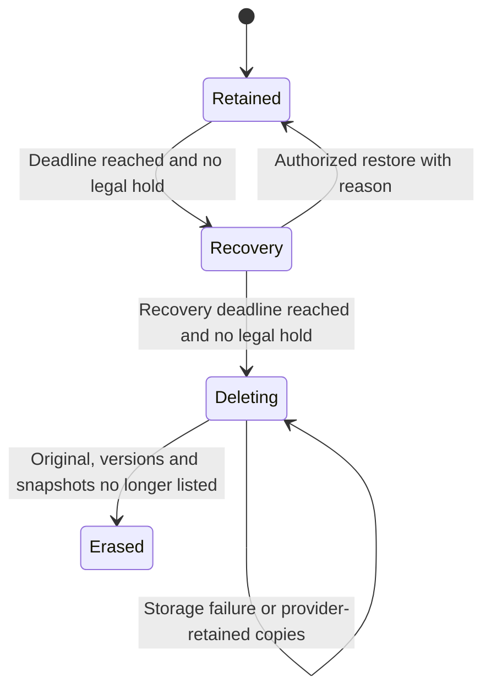

# KYC retention policy and operations

Date: 2026-11-12. StarterTemplate ships an enabled general-business schedule. It is a product default for ordinary SaaS customer onboarding, not a claim that one period satisfies every industry or jurisdiction. Mandatory KYC approval and StarterTemplate's IAM and tenant boundaries remain in force.

## Shipped schedule

| Evidence / event | Retention | Starting event |
| --- | --- | --- |
| Approved customer | Throughout the relationship, then 24 calendar months | Staff explicitly record the end of the relationship after suspending the workspace. Suspension by itself starts no clock. |
| Declined or withdrawn application | 90 days | Staff record decline or withdrawal. |
| Unfinished application | 30 days without activity | Case assignment or most recent document upload / reviewer activity. |
| Recoverable expiry | 30 further days | The worker first moves due evidence into Recovery. Original downloads and new collection stop. |
| Unattached uploads | 7 days of grace, plus no live upload reservation | Original blob's last modification. A worker rechecks metadata ownership before committing cleanup. |
| Legal hold | Until explicitly released; review every 90 days | Placement or recorded review of the hold. An overdue review never releases a hold. |

These periods balance a short sales/onboarding cycle, time to handle disputes and correction requests, and avoiding indefinite retention of failed applications. Approved evidence is available during service delivery; the additional two years is a provisional commercial support/dispute period. They are editable business choices. Kenya's [Data Protection General Regulations, regulation 19](https://www.odpc.go.ke/wp-content/uploads/2024/03/THE-DATA-PROTECTION-GENERAL-REGULATIONS-2021-1.pdf) require an appropriate retention schedule and periodic review; they do not prescribe this application's 24-month or 90-day defaults. A regulated downstream application must publish the schedule that applies to its activity; do not assume this neutral profile satisfies AML, banking or health-record requirements.

Existing customer cases receive the current policy on their first retention assignment. Unfinished legacy cases receive a fresh activity instant then, avoiding immediate deletion based on an old upload timestamp. Approved cases receive no expiry until their relationship end is explicitly recorded.

## Amend policies and manage cases

Open **Control Panel → KYC Retention Policy** (`/control-panel/kyc/retention`). `control_plane.view_kyc` permits viewing; `control_plane.manage_kyc_retention` permits publication and case schedule operations. Both require explicit platform membership and normal MFA. Tenant roles cannot confer these reserved permissions.

Publishing requires a name, positive periods and a reason. It creates an immutable version and changes the default for new cases. It does not rewrite existing cases. Each case shows its pinned policy and retention/recovery dates. **Apply Current Policy to This Case** is an explicit, reasoned operation; the original closure/relationship-end event remains the clock anchor. Concurrent edits are rejected so staff refresh before retrying.

From **KYC Cases → Open Case → Case Retention and Legal Holds**, record decline, withdrawal or relationship end, place/review/release a hold, or restore evidence during Recovery. Holds require the independent `control_plane.manage_kyc_holds` permission. Restore reopens the review case and recalculates an inactivity deadline; it does not activate a tenant, approve KYC, or grant IAM authority. Once storage erasure commits, restore and new holds cannot promise recovery. Reasons should be case references, not document contents.

## Automatic processing and recovery

The worker is registered and enabled, with a one-minute sweep, at most 25 due cases per sweep and 100 originals per orphan-list page. There is no disabled-by-default deletion switch. A lost orphan scan cursor causes a safe rescan; durable upload reservations and erasure records determine correctness.

Case revisions fence holds, collection, approval and deletion claims. Uploads reserve their opaque storage identity before writing a blob; completion changes that reservation and case revision with metadata in one database save. Orphan cleanup must win the same reservation fence. Deletion jobs persist an expiring lease and retry time. Storage failure is visible as StorageUnavailable or StorageProtected; remaining soft-deleted copies report ProviderRetention. Retries are idempotent, and a process restart resumes committed work.

A separate private erasure ledger stores opaque case/object identifiers, without documents, names, emails or review contents. The worker commits intent there before deleting originals. Downloads and collection consult it, so an older database/blob restore cannot silently revive an erased case. Approval and reactivation also consult the independent ledger and fail closed if its status cannot be checked. Preserve this ledger independently; never roll it back with a customer database. Minimal IDs and lifecycle receipts remain for reconciliation. Original filenames, checksums, uploader labels and review notes are removed when physical erasure completes; case-operation reason notes are then redacted. This is evidence retention, not deletion of the tenant or its IAM accounts. An erased case is terminal in this onboarding slice; a returning relationship needs fresh onboarding. Same-workspace review renewal is a separate extension, not a recovery action.

## Azure and backup boundary

Local Azurite can demonstrate the application workflow, private access, retries, fencing, orphan cleanup and restore denial. It cannot certify Azure versioning, immutable policies, legal holds, soft-delete expiry, external exports or a cloud backup product.

Azure deletion enumerates the exact object's versions and snapshots and verifies absence. [Soft-deleted copies](https://learn.microsoft.com/en-us/azure/storage/blobs/soft-delete-blob-overview) may remain until the provider period expires. Storage protection or missing permissions must leave deletion pending; the application must never claim those copies were erased. Application holds do not override Azure immutability.

For the first cloud deployment use a **35-day maximum recoverable database/blob backup window**, private originals and a separate private ledger container. Set backup/export retention explicitly in the chosen deployment; a local application cannot configure an unspecified cloud backup service. Preserve the opaque ledger beyond every restorable backup and replay it before restored data is exposed. Destroy isolated rehearsal restores after verification. Cloud storage, IAM/RBAC, provider-expiry and backup/restore evidence remain part of the already-pending cloud sign-off; the application policy is enabled locally.

`KycDocuments:ErasureLedgerContainerName` defaults to `kyc-erasure-ledger`. The original container defaults to `kyc-documents`. Use different private containers. The application's managed identity needs the original-container list/read/write/delete operations and ledger read/create operations. Azurite uses the same ignored local connection setting. Never put credentials in this guide.

## Verification

- Domain tests cover relationship-end anchors, calendar months, decline/withdrawal, inactivity, indefinite holds, review dates, recovery, committed deletion and retry leases.
- Integration acceptance exercises policy publication and pinning, explicit adoption, permission boundaries, upload, legal hold, recovery, provider-retention retry, private Azurite erasure, metadata cleanup, older-backup denial and orphan upload leases in disposable SQL/storage resources.
- Real platform authorization tests use password sign-in, authenticator enrollment and a fresh MFA sign-in, including KYC-only and platform-reader profiles. Transport fixtures that supply claims remain supplemental.

### Completed local acceptance: 2026-11-12

- SQL Server and PostgreSQL fresh, upgrade and repeat migration checks passed, including trusted legacy-grant conversion without granting approval to managers who lacked it.
- Private Azurite acceptance passed policy publication/pinning/adoption, holds, recovery, provider-retention retry, storage outages/protection, completed erasure, metadata cleanup, older database/blob restore denial and durable orphan retries after originals disappear from inventory.
- Restored open-case records cannot approve erased KYC; erased or unavailable evidence status cannot reactivate a workspace. Private KYC bodies and review/evidence/reason fields are excluded or redacted from debug request logs.
- Browser acceptance published a disposable policy version and placed/released a hold using a real password/MFA session. Case pinning and operator visibility were observed.
- The working local ST SQL database was backed up with checksum and verified before `AddKycRetention` and `GranularPlatformPermissions`. All three retained contexts report zero pending local migrations.
- Builds pass with existing package/analyzer warnings, including the existing WebUtilities advisory. The separate MediatR 14.3.0 update and unrelated menu/payment edits were preserved.

Final runtime check: Docker API `/health/ready` returned 200/Healthy; the Blazor `/iam/sign-in` shell returned 200. The deployed API resolves MediatR 14.3.0. The actual local database still selects General Business with 24/90/30/30/7/90 periods, contains 24 platform operation definitions and no retired direct management grants. Both app containers were refreshed. The disposable browser processes, five owned containers, ports and temporary credential/key directory were removed. Source changes remain uncommitted in the single StarterTemplate worktree.
